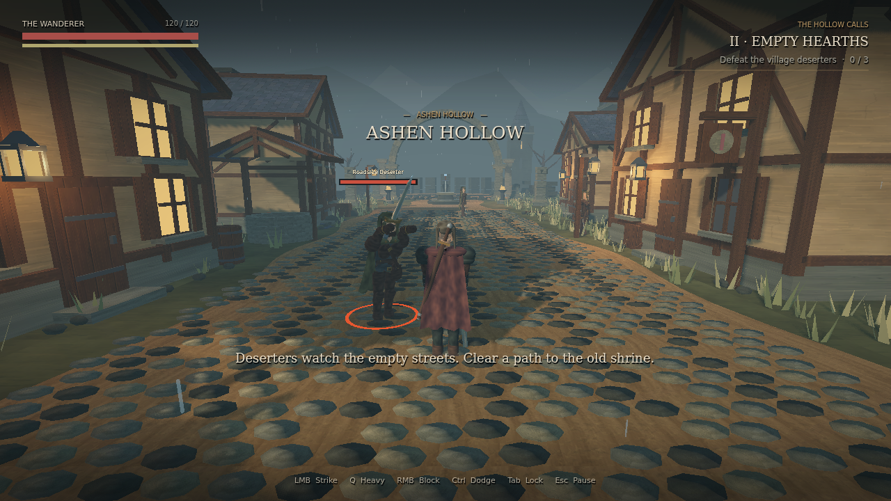

# Ashen Hollow

**A complete, single-player third-person dark fantasy action RPG prototype.**

A road without travelers. A village without bells. A broken oath beneath the old stones.
Play an original wandering swordsman through a compact forest, abandoned village, shrine,
and ruined court. Defeat three deserters, read the shrine's inscription, and confront the
antlered Hollow Warden.



## Play on Windows

1. Download and extract **Ashen_Hollow_Windows.zip** from the repository's `releases` folder.
2. Run **AshenHollow.exe**. No Godot installation or other game dependencies are needed.
3. Choose **Begin Journey**. The normal renderer is **Forward+**.

If your graphics driver does not support Forward+, the included `Play_Compatibility.bat`
starts the same game with Godot's OpenGL compatibility renderer. Forward+ is the intended
presentation; compatibility has reduced rendering features.

The Windows executable was exported successfully from Godot 4.6.3. A native Windows
playthrough could not be performed in the Linux build environment. See the validation
report for the checks that were actually run.

## Open the source project

Use **Godot 4.6.3 standard**, without .NET. Import this folder's `project.godot`, allow the
first asset import to finish, and press **F6** on `scenes/main.tscn` or **F5** to run the game.
The project uses GDScript and built-in Godot features; no add-ons or external services are
required. `Ashen_Hollow_Source.zip` contains this complete editable project.

## Keyboard and mouse

| Input | Action |
| --- | --- |
| WASD | Move relative to the camera |
| Mouse | Orbit the camera |
| Shift | Sprint; consumes stamina |
| Space | Jump |
| Left Ctrl | Directional dodge with a short invulnerability window |
| Left mouse button | Light attack; click again during a swing to queue the next hit |
| Q | Committed heavy attack |
| Hold right mouse button | Block attacks coming from in front |
| Tab | Lock onto a nearby visible enemy; press again to unlock |
| Mouse wheel while locked | Cycle nearby targets |
| E | Inspect the shrine when its prompt appears |
| Esc | Pause / resume and release / capture the mouse |

The three-hit light combo deals progressively stronger damage. Heavy attacks break the
warden's poise more reliably. Attacks, sprinting, dodging, and blocking spend stamina;
leave a short opening to recover it. Blocking with insufficient stamina breaks your guard.
An orange ground ring and enemy pose telegraph each attack. Evade the warden's lunge,
then punish its recovery; its wide sweep requires different spacing.

## The short quest

1. Follow the forest path into Ashen Hollow.
2. Defeat the **three village deserters**. The objective tracks each defeat.
3. Continue beyond the village to the blue-lit shrine and press **E** nearby. Reading the
   oath restores up to 35 health, refills stamina, and wakes the guardian.
4. Enter the ruined court and defeat **the Hollow Warden**.
5. The completion screen offers continued exploration or a fresh run.

Death offers a restart of the short quest with player stats, enemies, and objectives reset.
The prototype has no persistent save, inventory, equipment progression, or multiplayer.

## Implemented systems

- Accelerated camera-relative movement, smooth turning, sprint, jump, orbit collision,
  lock-on and target cycling.
- Buffered three-hit sword combo, heavy attacks, block and guard break, stamina, directional
  dodge invulnerability, wall-aware 3D hit queries, hit reactions, knockback, death and reset.
- Bandit patrol/detection/chase/attack/recovery/stagger/death states; a tougher creature
  with lunge, sweep, poise and separate attack telegraphs.
- Five quest stages, proximity interaction, gated boss awakening, completion and retry.
- Main menu, controls, HUD, enemy health, target health, objectives, region announcements,
  pause, death and victory screens.
- Modeled and articulated characters with procedural animation, moving cloak, painted
  textures, timber architecture, ruins, forest, dusk fog, warm lights and sparse drizzle.
- Original synthesized ambience, sword/guard/impact sounds, hit sparks and camera feedback.

## Structure

```text
scenes/                Reusable player, enemy, and main scenes
scripts/main.gd        Quest and menu lifecycle; signal wiring
scripts/player/        Player state, combat, orbit camera and targeting
scripts/enemies/       Enemy finite state machines and collision strikes
scripts/art/           Original character meshes and animation choreography
scripts/world/         Authored environment assembly and texture generator
scripts/ui/            Menus, HUD and feedback
scripts/effects.gd     Spatial sound and short-lived impact effects
assets/                Painted textures, original WAV samples, licensed fonts
tests/                 Player, enemy, and full-scene regression suites
docs/                  Screenshots, architecture, validation report
export_presets.cfg     Windows x86-64 release export, embedded game data
```

## Verify and export

Run from this project directory with `godot` on PATH:

```sh
godot --headless --editor --import --quit
godot --headless --path . --fixed-fps 60 --script tests/player_checks.gd
godot --headless --path . --fixed-fps 60 --script tests/enemy_checks.gd
godot --headless --path . --fixed-fps 60 --script tests/integration_checks.gd
godot --headless --export-release "Windows Desktop" builds/windows/AshenHollow.exe
```

For export, install the official **4.6.3** export templates through Godot's template manager
and create `builds/windows` first. Shader and import caches in `.godot/` are generated
locally and intentionally excluded. On sandboxed Linux machines, use writable
`XDG_CONFIG_HOME`, `XDG_DATA_HOME`, and `XDG_CACHE_HOME` directories.

See [the test report](docs/TEST_REPORT.md) for observed results and limits. Rendering was
inspected under Forward+ on Linux software Vulkan; this does not establish a performance
target for Windows GPUs.

## Asset credits

The character art, environment geometry, painted texture maps, sound effects, and game
code were created for this prototype. Fonts are DejaVu Serif and DejaVu Sans; their
license is included in `assets/fonts/LICENSE.txt`. Godot is MIT-licensed; see
`docs/GODOT_LICENSE.txt` for the engine license distributed with the executable.
